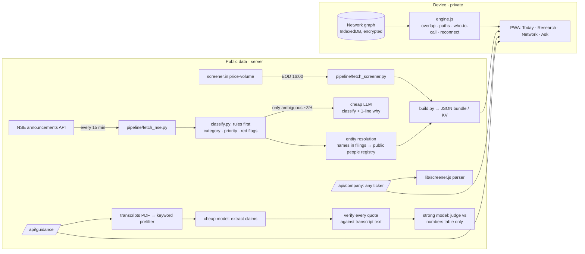

# FINN: Financial Investment Agent

A mobile-first investor workflow with three layers that feed each other:

- **Push.** What changed across the portfolio, ranked: a few full cards, one-liners, and routine filings folded away. Price and volume alerts use thresholds you set, and each move is checked against the filing that explains it.
- **Pull.** Research on any NSE ticker, grounded only in primary data. The core view is **promised vs delivered**: management's own transcript quotes, tracked over time, checked against reported numbers.
- **Network.** Your contacts as an intelligence layer that appears inside Push and Pull: who worked with the incoming CFO, who to call about a regulatory halt, two-hop paths to a new MD, an expertise map, and natural reasons to reconnect. It runs entirely on-device.

> **Demo snapshot:** Sun 15 Nov 2026, 08:00 IST. It contains 78 real NSE filings (3–15 Nov), 30 sessions of real EOD price and volume for 18 holdings, and real screener fundamentals. Guidance quotes come from PI Industries' and Kaynes' own transcripts. **The 32 network contacts are synthetic.** Their employers are real so the overlap engine has something to match against.

## Try it
| | |
|---|---|
| Live app | `(https://enam-holdings-tau.vercel.app)` (open on a phone) |
| Things to tap | Today → Kaynes results card (auditor flags + who to call) · HDFC Bank CCO card (bio → your path in via an ex-ICICI colleague) · Research → PIIND → *Promises* · Research → type any ticker (e.g. `NAVINFLUOR`) · Ask (centre button) → "Who knows Raghu Panicker?" · Alerts → drag the thresholds |

## Run locally
```bash
npm install
node dev.js                     # http://localhost:3000 (static app + /api)
FINN_OFFLINE=1 node dev.js      # no internet: /api serves a fixture
GEMINI_API_KEY=... node dev.js  # enables live promised-vs-delivered for any ticker
npm test                        # parser, quote verification, analysis engine
python3 pipeline/build.py       # rebuild public/data from data/raw
```

## Deploy (free)
1. Push to GitHub, then on Vercel choose **Import Project** (framework: *Other*, no build command, output directory: `public`).
2. Add the env var `GEMINI_API_KEY` (free key from Google AI Studio). Without it, everything works except live guidance extraction.
3. `api/*.js` become serverless functions automatically (`vercel.json` sets a 60s max duration).

## Architecture


### Data pipelines
- **Filings.** `fetch_nse.py` polls NSE per symbol. `classify.py` maps them to the reference categories with regex rules and scores a priority from 0 to 100: senior roles score above independent directors, and auditor restatements, "could not review" notes and regulator halts add to the score. Priority then decides how a filing is shown: a full card (score 70 or more), a one-liner (35–69), or folded away. Filings for the same company and event within 72 hours are grouped into one story. In this snapshot the rules placed every filing, so the LLM fallback was never called.
- **Prices.** EOD close and volume. Alerts compare each move against the user's thresholds over a 10-session volume baseline. Special sessions such as Diwali Muhurat are excluded. Each alert is linked to a filing from the previous 36 hours, or flagged as "no filing explains this".
- **Fundamentals.** Fetched live per ticker from screener.in, consolidated with a standalone fallback, and parsed into one schema. Responses are CDN-cached for 12 hours.
- **People.** Names are pulled out of filing text. The Reg-30 "brief profile" annexure is the primary bio, enriched from public professional profiles, and stored in a **public** registry. Linking a filing name to a person in your network happens **on-device** by comparing employer tenures (with org aliases, e.g. Mentor Graphics → Siemens EDA), schools and years. Every link carries a confidence label: *worked together*, *same team, likely overlapped*, *on the board of their employer*, *same firm, different years*, or *years not public*. Paths up to two hops use tie strength and recency.

### Security & privacy
- **The network never leaves the device.** The server sees only public data (filings, fundamentals, public profiles of people named in filings). Matching, who-to-call, reconnect and the expertise map run in the browser (`public/js/engine.js`).
- **In production:** the contacts graph sits in IndexedDB, encrypted with a key held by a passkey (WebAuthn). Optional multi-device sync is end-to-end encrypted, so the server stores only ciphertext. The investor imports their own contacts or LinkedIn data export (with consent and per-contact delete), and no profiles are scraped. Public-person profiles are kept only while a person is in an active filing (90-day TTL) with source links. Contact notes can be exported or deleted at any time.
- **Access control:** a single user per network. Team sharing would be opt-in, per contact, with role-based access and an audit log. Who-to-call cards warn when a contact is a current insider, so nobody asks them for unpublished price-sensitive information.
- **LLM calls never include contacts.** Only public filing or transcript text is sent to a model.

### LLMs & agents
| Step | Model | Why |
|---|---|---|
| Filing classification + priority | **Rules** (0 tokens) | 78 of 78 placed; deterministic and auditable |
| Ambiguous filings, one-line "why it matters" | Gemini Flash-Lite | bulk, short, cheap |
| Guidance extraction per transcript | Gemini Flash-Lite on keyword-prefiltered text (~9k chars vs ~60k) | bulk extraction; about 85% fewer tokens |
| Quote verification | **Code** (5-word shingle match) | stops hallucinated quotes before judgement |
| Promised-vs-delivered verdicts | Gemini Flash (stronger) | reasoning across quarters; fed only verified quotes plus a numbers table, never outside knowledge |
| Bull/bear, red flags, results tables | **Code** (`analyse()`) | numbers should never be generated by a model |

The research flow is a fixed pipeline (fetch → filter → extract → verify → judge), not an open-ended agent: it's cheaper, reproducible, and every step can be tested. The Ask box is an intent router over the same engines, with Web Speech for voice. A cost estimate for one live company is about 20k tokens, which fits the free tier. Results are cached for a week because transcripts change quarterly.

### Cloud
- **Vercel:** static PWA (CDN) plus two serverless functions, with Cache-Control as the cache layer.
- **Production additions:** a cron worker (Vercel Cron or GitHub Actions) for NSE polling and EOD; a KV/Postgres store for filings and alerts; web-push notifications for triggered alerts.
- **Rationale:** zero ops, a free tier, and functions colocated with the CDN. Nothing stateful about the user sits on the server.

## Deliberately left out
- Live NSE polling in the deployed demo. The snapshot is frozen so the demo is reproducible; the fetchers are in `pipeline/`.
- Parsing results PDFs for the latest quarter. Kaynes filed at 23:42 on the deadline, and the card says so honestly instead of guessing.
- Real LinkedIn data. The network is synthetic by design; see the privacy notes above.
- Auth, push notifications, multi-user. These are not needed to prove the workflow.

## Next
Results-PDF parser (XBRL from NSE), web-push alerts, a contacts import wizard, "prep me for this meeting" briefs that combine all three layers, and per-sector KPI trackers (order book, AUM, GNPA).

## Repo map
```
public/            PWA (index.html, styles.css, js/app.js UI, js/engine.js all logic, data/ snapshot bundle)
api/               serverless: company.js (any ticker), guidance.js (promised vs delivered), health.js
lib/               screener.js parser, guidance.js (prefilter → extract → verify → judge), llm.js routing
pipeline/          fetch_nse.py, fetch_screener.py, classify.py, build.py
data/raw/          raw pipeline outputs + curated guidance/people + synthetic network
test/              offline tests + screener-shaped fixture
dev.js             zero-dependency local server
```
